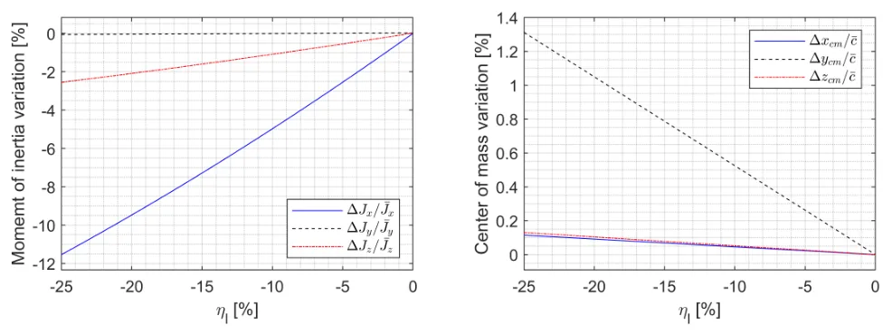

A morphing aircraft changes its shape in flight. That sounds like a pure win — a long wing for efficient cruise, a short one for a fast dash — until you try to write the controller. This post walks through the core idea of my Ph.D. work, published as [*Self-Scheduled LPV Control of Asymmetric Variable-Span Morphing UAV*](../papers/2023-self-scheduled-lpv-asymmetric-morphing-uav.html) (*Sensors*, 2023), and the parts of it I still find useful outside aerospace.

## Why morphing is awkward to control

Conventional control surfaces are well-behaved inputs: an aileron produces mostly roll moment, through a long moment arm, with a small aerodynamic force. Changing the wing span is different:

- **It moves several things at once.** Span changes lift, drag, and moments on more than one axis, and the relationship is strongly nonlinear.
- **It moves the aircraft itself.** The center of mass, moments of inertia, and products of inertia all shift as the wingtips travel.
- **It is slow.** Morphing actuators have much lower bandwidth than hydraulically driven control surfaces, and a controller that ignores that gap performs badly.

The classical answer is gain scheduling: design linear controllers at a set of operating points and interpolate between them. The catch is that classical gain scheduling only behaves when the scheduling variable changes *slowly*. Assume the shape changes slowly, and you have thrown away the main reason to morph in the first place.

## The trick: schedule on one part, steer with the other

The aircraft model lets the left and right wingtips telescope independently. Each has a span-variation ratio, \(\eta_l\) and \(\eta_r\), between −25 % and 0 %. Instead of treating them as two separate knobs, decompose them:

$$
\eta_s = \frac{\eta_l + \eta_r}{2}, \qquad \eta_a = \frac{\eta_l - \eta_r}{2}
$$

The two parts do very different jobs:

- The **symmetric part** \(\eta_s\) has large effects on longitudinal aerodynamics and overall flight performance. It becomes a **scheduling parameter**, alongside airspeed and altitude.
- The **asymmetric part** \(\eta_a\) barely affects longitudinal motion, but the left–right difference produces a rolling moment. It becomes a **control input** for the lateral-directional axis, next to the ailerons and rudder.

That one change of variables is most of the design. Each quantity now has a single, clear role.

<figure>
  
  <figcaption>How the aircraft's parameters change as only the left wingtip retracts (\(\eta_r = 0\)). Fig. 2 of the paper, CC BY 4.0.</figcaption>
</figure>

## Building a model you can trust across the envelope

The baseline is NASA's open-source Generic Transport Model (GTM-T2), a 5.5 %-scale transport aircraft with high-fidelity aerodynamics, sensors, and actuators. GTM ships with damage cases, including the loss of 25 % of the left wingtip. Read that case as "the wingtip retracted" instead of "the wingtip broke off," let both tips telescope continuously, and you get a variable-span model. Mass and center of mass vary linearly with the morphing parameters; the inertia terms vary quadratically. The model is quasi-static — the unsteady aerodynamics *during* morphing are not modeled, because the base model does not include them.

LPV synthesis needs a rectangular parameter domain, but the region where GTM can trim is triangular in airspeed–altitude space: the usable speed range narrows with height. A synthetic airspeed stretches it back into a rectangle:

$$
V_S = V_0 - \frac{h_0}{h_0 - h}\,(V_0 - V_T), \qquad h < h_0,
$$

with \(V_0 = 100\) kt and \(h_0 = 30{,}000\) ft. The final grid is 7 synthetic airspeeds × 3 altitudes × 3 symmetric-morphing settings = **63 operating points**. At each one, the nonlinear model is trimmed and linearized; interpolating the family of linear models gives the LPV model.

The grid is a trade-off: too coarse and the LPV model misses the nonlinearity, too fine and the synthesis becomes slow or infeasible. The only honest way to know it is dense enough is to compare the LPV model against the nonlinear simulation.

## Controllers on top

On that model, the paper designs three layers:

1. **Control augmentation systems** that track normal acceleration, sideslip angle, and roll rate. The slow morphing actuator is handled inside the design through frequency-dependent weighting filters.
2. **Autopilots** for airspeed, altitude, sideslip angle, and roll angle.
3. A **nonlinear guidance law** for three-dimensional trajectory tracking: waypoints, a 2,000 ft orbit, a helical climb, and a spiral descent.

The key property of a self-scheduled LPV controller is that its stability guarantee holds for **arbitrarily fast** parameter variation, not just at the design points. Designing it means solving a hard optimization offline; running it is cheap, because the result is a gain-scheduled linear controller.

## What happened in simulation

The comparison that matters is against an \(H_\infty\) design with the same settings:

- In a **helical climb with extremely fast morphing**, the \(H_\infty\) controller's oscillation grew until it diverged. The LPV controller kept tracking the path.
- In a **spiral descent where the wing shape was scheduled on flight conditions**, the \(H_\infty\) loop lost stability even though the parameter changed gently. The LPV controller again held the trajectory.
- In the orbit, the \(H_\infty\) design also chattered from its aggressive high gains.

Both controllers look fine at a fixed operating point. The difference only shows up *between* operating points and *while* the parameters move — which is exactly where a morphing aircraft spends its time.

## What I took away from it

I now work on production ML rather than flight control, but a few habits from this project transfer directly:

- **Test the transitions, not just the points.** A model or controller validated only at fixed operating conditions can fail as soon as conditions move. The evaluation has to include the moves.
- **Give every variable one job.** Separating "what describes the situation" (\(\eta_s\), airspeed, altitude) from "what I get to act with" (\(\eta_a\), ailerons, rudder) made an over-actuated, coupled problem tractable.
- **Check the surrogate against the real thing.** The LPV controller is only as good as the LPV model's match to the nonlinear one, so that comparison was part of the design loop, not a final checkbox.
- **Pay compute up front.** Heavy optimization at design time bought a controller that costs almost nothing at run time.

The open problem the paper ends on is choosing the *best* shape online — a long span when lift is needed, a short one for a dash or a fast roll. With one morphing parameter it is a line search; with several, it becomes a real optimization problem that has to respect both flight conditions and guidance commands.

## Code and paper

- Paper: [Sensors 2023, 23(6), 3075](https://doi.org/10.3390/s23063075) (open access) · [paper page](../papers/2023-self-scheduled-lpv-asymmetric-morphing-uav.html)
- Dissertation: [Self-Scheduled Parameter-Varying Control of Asymmetric Variable-Span Morphing UAV](../papers/2023-phd-dissertation-lpv-asymmetric-morphing.html) (Seoul National University, 2023)
- Code: [`jihoonlee91/gtm-lpv-control`](https://github.com/jihoonlee91/gtm-lpv-control) — MATLAB/Simulink, built on [NASA GTM_DesignSim](https://github.com/nasa/GTM_DesignSim) and LPVTools

*Work done with Seong-Hun Kim, Hanna Lee, and Prof. Youdan Kim at the SNU Flight Dynamics and Control Lab, supported by the Ministry of Trade, Industry and Energy of Korea.*
